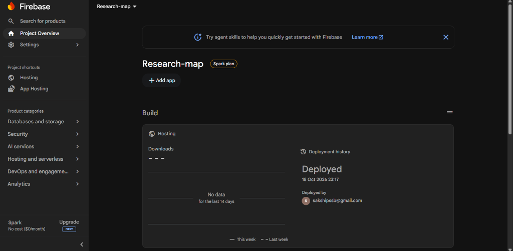
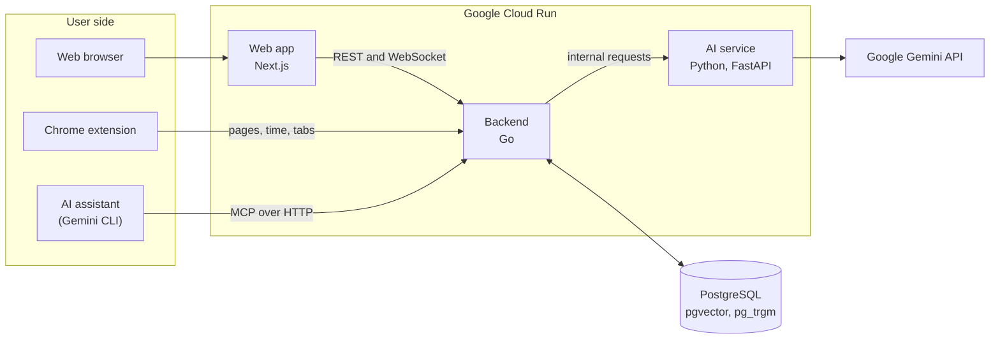
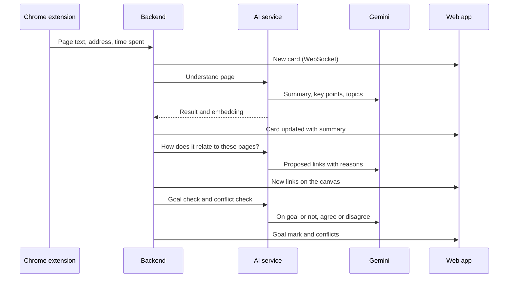

# Research Map

An AI research workspace that turns browsing into a clear, shared map of what you read and learned. Powered by Google Gemini.

### Live Deployment Evidence (Firebase Hosting)


| | |
|---|---|
| **Live Frontend** | [https://researhmap.in](https://researhmap.in) / [https://research-map-88f54.web.app](https://research-map-88f54.web.app) |
| **Frontend Hosting** | Firebase Hosting (Google Cloud) |
| **Backend API** | [https://research-map-api-812274791846.asia-southeast1.run.app/api/v1/readyz](https://research-map-api-812274791846.asia-southeast1.run.app/api/v1/readyz) |
| **Backend & AI Hosting** | Google Cloud Run (asia-southeast1) |
| **Built with** | Google Gemini API, Google Cloud Run, Firebase Hosting, Next.js, Go, Python, PostgreSQL |

---

## Table of contents

1. [The problem](#the-problem)
2. [Our solution](#our-solution)
3. [Who it is for](#who-it-is-for)
4. [Key features](#key-features)
5. [What makes it different](#what-makes-it-different)
6. [How Google Gemini is used](#how-google-gemini-is-used)
7. [Architecture](#architecture)
8. [Deployment on Google Cloud](#deployment-on-google-cloud)
9. [Technology stack](#technology-stack)
10. [Running locally](#running-locally)
11. [Connecting an AI assistant (MCP)](#connecting-an-ai-assistant-mcp)
12. [Security and privacy](#security-and-privacy)
13. [Testing](#testing)
14. [Project structure](#project-structure)
15. [Future work](#future-work)
16. [License](#license)

---

## The problem

We use the browser to search topics, learn new things and research for our work. During this research:

- Too many tabs stay open, and it becomes hard to find which page said what.
- Once the tabs are closed, the pages and what we learned from them are lost.
- Notes, links and conclusions are kept in different places, or not kept at all, so the same pages are read again later.
- It is easy to move away from the topic and spend time on pages that are not related to the task.
- Sharing research with a teammate means writing a summary by hand or sending a long list of links.

These problems cost time every day, lead to repeated reading, and make decisions hard to explain or check later.

## Our solution

Our product records the research while it happens and organises it automatically. A Chrome extension records the pages you read, Google Gemini explains each page in a few plain sentences, and every page appears on a shared visual canvas, connected to the pages it relates to. If you set a goal, the product also tells you when a page is not part of that goal.

How it works:

1. **Create a workspace** for a task, for example "Choose a CRM for our sales team", and optionally set a goal.
2. **Click Start Tracking** and browse as usual. Each page you stay on for a few seconds is added to the canvas.
3. **Gemini reads each page** and writes a short summary, key points and topics. It then links the page to related pages already on the canvas and explains the link.
4. **Goal check.** If a goal is set, each new page is compared with it. Unrelated pages are marked, and the extension shows a short notice so you can go back or mark the page as relevant.
5. **Session report.** When the session ends, Gemini writes a report in plain paragraphs, with numbered links to the sources and a breakdown of where the time went.
6. **Share.** The workspace can be shared with a link, as view only or with edit access, and everyone sees the same canvas update live.

AI assistants can also work on the canvas. Through the built-in MCP server, Gemini CLI or another assistant can create a workspace from a single prompt, set the goal, add sources and findings, and the user watches the work appear live.

---

## Who it is for

| User | Example task |
|---|---|
| Teams choosing tools or vendors | Compare CRM, project management or cloud providers and share the result with the team |
| Analysts and consultants | Research a market or a client topic and hand over a report with sources |
| Product managers and engineers | Learn a new technology and keep a clear record of what was read |
| Students and researchers | Study a subject, track time on topic, and keep notes linked to sources |

---

## Key features

| Feature | What it does |
|---|---|
| Visual canvas | Every page is a card with its title, preview and summary. Lines show how pages relate and how you moved from one page to the next. |
| Automatic capture | The Chrome extension records pages, time spent and the page that opened each tab. Sites on the private list (email, chat, social media, payments) and pages with a password field are never captured. |
| Page summaries | Gemini writes a 3 to 5 sentence summary and up to 6 key points for each page, in simple formal English. |
| Smart links | Gemini decides how a new page relates to earlier ones (explains, supports, contradicts, example of, alternative to, and others) and gives the reason. |
| Goal tracking | Gemini turns the goal into key topics, checks each page against them, and shows the time spent on and off the goal. |
| Conflict Radar | Finds sources that disagree, explains the difference, and lists what to check in each source. It never decides who is right. |
| Session report | A one-page report with summary paragraphs, key points, sources and a chart of time per site. It can be printed or saved as PDF. |
| Real-time sharing | Share links with view or edit access. Changes appear for everyone at the same time. |
| Views and search | Canvas, list and timeline views, plus search by meaning and by keywords across a workspace. |
| Export | Markdown, CSV, BibTeX, JSON, Mermaid and bookmarks, plus a PNG image of the canvas. |
| AI assistant access (MCP) | Gemini CLI and other MCP clients can research directly into a workspace. AI work goes to a separate "AI Agent" branch, so the user reviews it before copying it to the main canvas. |

---

## What makes it different

- **Capture without extra effort.** Bookmarks and note apps need manual work. Our product records the research in the background while you read.
- **Understanding, not only links.** Each page comes with a summary, key points and an explained relation to other pages, so the canvas shows what was learned, not only where you went.
- **Focus support.** The goal check gives a gentle notice when you drift away from the task, and the report shows how much time went to the goal.
- **Honest about disagreement.** Conflict Radar shows where sources disagree and what to verify, instead of hiding the difference.
- **Humans and AI on the same canvas.** People and AI assistants add to the same workspace. AI work is kept on its own branch until a person accepts it.

---

## How Google Gemini is used

Gemini is the main AI in every step. Requests use `gemini-flash-latest` for longer reasoning and `gemini-flash-lite-latest` for fast checks. Several API keys are rotated automatically, and when a model is busy the request moves to the next model.

| Step | What Gemini does |
|---|---|
| Understand a page | Decides whether the page is research, writes the summary, key points and topics, and lists the questions the page answers. |
| Place a page | Compares the new page with related pages and proposes links with a written reason. |
| Goal plan | Rewrites the goal in clear words and lists the 3 to 6 topics needed to reach it. |
| Goal check | Decides whether a page belongs to the goal and explains why. |
| Conflicts | Compares claims from different sources and labels them as agreeing, contradicting or different in context. |
| Session report | Writes the report paragraphs and key points, citing each source by number. |
| Background sources | Suggests encyclopedia articles that give useful background when an AI assistant starts new research. |

All prompts ask for structured JSON, so every result is checked before it is saved. Page text is always passed as data, and Gemini is told never to follow instructions found inside a page.

Text embeddings for search and for finding related pages are created inside the AI service with FastEmbed (`BAAI/bge-small-en-v1.5`), so this step does not depend on an external API.

---

## Architecture

### System overview



| Component | Role |
|---|---|
| Web app | Canvas, list and timeline views, reports, sharing and settings. It forwards API and MCP requests to the backend. |
| Backend | Accounts, workspaces, page capture, the AI pipeline, live updates over WebSocket, access control and the MCP server. |
| AI service | All Gemini calls, provider routing and embeddings. It is reachable only by the backend, using a shared internal key. |
| Database | Workspaces, pages, cards, links, sessions and reports, with vector search (pgvector) and text search (pg_trgm). |
| Chrome extension | Records pages and time, follows which page opened which tab, and shows goal notices. |

### What happens when a page is captured



Each result is shown on the canvas as soon as it is ready, so the user never waits for the whole pipeline to finish.

---

## Deployment on Google Cloud

The web application is deployed on Firebase Hosting and the backend microservices run on Google Cloud Run:

| Service | Platform | Source folder | Live URL / Endpoint | Notes |
|---|---|---|---|---|
| Frontend Web App | Firebase Hosting (Google Cloud) | `frontend/` | [https://researhmap.in](https://researhmap.in) / [https://research-map-88f54.web.app](https://research-map-88f54.web.app) | Public global edge CDN hosting with custom domain and SSL. |
| Backend API | Google Cloud Run | `backend/` | [Cloud Run Readyz Endpoint](https://research-map-api-812274791846.asia-southeast1.run.app/api/v1/readyz) | Public auto-scaling container. Handles REST APIs, WebSockets, and long-lived MCP assistant connections. |
| AI Service | Google Cloud Run | `agent/` | Internal Cloud Run | Private microservice called by backend. Gemini API keys are securely stored in Secret Manager. |

The database is a managed PostgreSQL instance with the pgvector extension. The backend creates and updates the tables when it starts.

After deployment, the web app address is added to `externally_connectable` in `extension/manifest.json`, so the extension can connect to it.

---

## Technology stack

| Layer | Technologies |
|---|---|
| AI | Google Gemini API (`gemini-flash-latest`, `gemini-flash-lite-latest`), FastEmbed |
| Cloud | Firebase Hosting, Google Cloud Run, Secret Manager |
| Web app | Next.js 16, React 19, React Flow, Zustand, TanStack Query, Tailwind CSS |
| Backend | Go, Gin, pgx, goose migrations, WebSocket, MCP Go SDK |
| AI service | Python, FastAPI, httpx |
| Database | PostgreSQL with pgvector and pg_trgm |
| Extension | Chrome Manifest V3, Mozilla Readability |

---

## Running locally

### Requirements

- Go 1.26 or newer
- Python 3.12 or 3.13 with [uv](https://docs.astral.sh/uv/)
- Node.js 20 or newer
- Google Chrome
- PostgreSQL with the pgvector extension (a free [Neon](https://neon.tech) database works)
- At least one Gemini API key from [Google AI Studio](https://aistudio.google.com/apikey)

### 1. Settings files

Copy each example file and fill in the values. Real settings files are ignored by git.

| File | Main values |
|---|---|
| `backend/.env` (from `backend/.env.example`) | `DATABASE_URL`, `JWT_SECRET`, `AGENT_INTERNAL_KEY`, `WEB_ORIGINS`, `AGENT_URL` |
| `agent/.env` (from `agent/.env.example`) | `AGENT_INTERNAL_KEY` (same value as the backend), `GEMINI_API_KEY_1` to `GEMINI_API_KEY_4` |
| `frontend/.env.local` (from `frontend/.env.example`) | `NEXT_PUBLIC_API_MODE=http`, `API_PROXY_TARGET`, `NEXT_PUBLIC_WS_URL`, `NEXT_PUBLIC_EXTENSION_ID` |

### 2. Start the three services

Each service runs in its own terminal.

AI service:

```bash
cd agent
uv sync
uv run uvicorn app.main:app --port 8000 --env-file .env
```

Backend (creates and updates the database tables on start):

```bash
cd backend
go run ./cmd/server
```

Web app:

```bash
cd frontend
npm install
npm run dev
```

Open http://localhost:3000 and create an account.

Health checks: `http://127.0.0.1:8000/health` (AI service), `http://localhost:8080/api/v1/healthz` and `http://localhost:8080/api/v1/readyz` (backend).

### 3. Install the Chrome extension

1. Open `chrome://extensions` and turn on **Developer mode**.
2. Click **Load unpacked** and select the `extension` folder of this repository.
3. In the web app, open **Settings** and click **Connect extension**. The extension receives its token and the server address automatically.

---

## Connecting an AI assistant (MCP)

The backend includes an MCP server at `/api/v1/mcp` (Streamable HTTP). In the web app, open **Settings**, click **Create MCP token**, and copy the command shown there.

**Gemini CLI.** Run the command in a normal terminal, not inside Gemini:

```bash
gemini mcp add -s user -t http -H "Authorization: Bearer YOUR_TOKEN" --trust research-map http://localhost:3000/api/v1/mcp
```

Then start `gemini` and ask, for example: *"Using Research Map, research the best CRM for our 20-person sales team. Set my goal as 'Pick a CRM for our sales team' and add every useful source."* The workspace, goal and sources appear on the canvas while Gemini works.

**Other clients:** use the same server address with the token as a Bearer token.

### MCP tools

| Tool | Purpose |
|---|---|
| `start_research` | Create or reuse a workspace for a topic, optionally set the goal, and add background sources |
| `list_workspaces` | List the workspaces the user can access |
| `search_workspace` | Search a workspace by meaning and by keywords |
| `get_node` | Read one card with its summary, key points and notes |
| `get_graph_outline` | Get a short outline of the whole workspace |
| `add_question` | Add a research question |
| `add_source` | Add a web page; the server reads the page and runs the AI pipeline on it |
| `add_note` | Add a note to a card or to the workspace |
| `add_finding` | Add a conclusion linked to the sources that support it |
| `link_nodes` | Suggest a link between two cards, with a reason |
| `list_conflicts` | List sources that disagree |
| `get_references` | List the sources of a workspace or session |
| `get_session_report` | Read the report of a research session |

---

## Security and privacy

- Passwords are stored as bcrypt hashes, login attempts are rate-limited, and sessions use httpOnly cookies.
- The extension and AI assistants use separate tokens that can be removed at any time in Settings.
- Every request checks that the user has access to the workspace. Viewers cannot change anything.
- The extension never captures sites on the private list (email, chat, social media, payments) or pages with a password field.
- Page text is treated as data only. Gemini is told never to follow instructions found inside a page.
- When the server reads a web page, local and private network addresses are blocked.
- API keys are kept in settings files that are ignored by git, and in Secret Manager when deployed.

---

## Testing

```bash
cd backend && go test ./...
cd agent && uv run pytest
cd frontend && npx tsc --noEmit
```

An end-to-end test of the MCP server runs against the running services. It covers creating content, the AI pipeline, live updates, access rules and network safety checks:

```bash
cd agent
uv run --with mcp --with websockets python ../scripts/mcp_e2e.py --api http://localhost:3000/api/v1
```

---

## Project structure

```
Ingress/
  backend/        Go backend: API, capture, AI pipeline, WebSocket, MCP server, database migrations
  agent/          Python AI service: Gemini prompts, provider routing, embeddings, tests
  frontend/       Next.js web app: canvas, views, panels, reports, settings
  extension/      Chrome extension: capture, time tracking, goal notices
  scripts/        End-to-end MCP test and demo data script
  docs/           Additional documentation
  devpost/        Planning documents: scope, product requirements and technical spec
```

---

## Future work

- Publish the extension on the Chrome Web Store for one-click installation.
- Team workspaces with roles managed at the organisation level.
- Connectors to save reports directly to Google Docs and Google Drive.
- Support for reading PDFs and videos with Gemini.

---

## License

This project is open source under the [MIT License](LICENSE).
